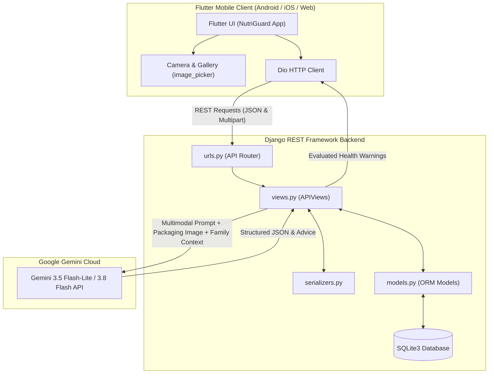

# 🛡️ NutriGuard: AI-Powered Packaged Food Allergen & Family Health Guard

[](https://flutter.dev)
[](https://dart.dev)
[](https://www.djangoproject.com)
[](https://www.django-rest-framework.org)
[](https://ai.google.dev)
[](LICENSE)

> **NutriGuard** is an intelligent mobile and cloud healthcare platform designed to protect individuals and families from dangerous allergens, hidden preservatives, and health risks in packaged foods. By integrating **Google Gemini Vision & Multimodal AI** with a **Flutter** mobile client and **Django REST Framework** backend, NutriGuard evaluates packaged foods against the individualized medical profiles, allergies, and pregnancy conditions of all family members in real-time.

---

## 📌 Table of Contents
- [Key Problems Solved](#-key-problems-solved)
- [Key Features](#-key-features)
- [System Architecture](#-system-architecture)
- [Technology Stack](#-technology-stack)
- [Repository Structure](#-repository-structure)
- [Getting Started](#-getting-started)
  - [Backend Setup (Django)](#1-backend-setup-django)
  - [Frontend Setup (Flutter)](#2-frontend-setup-flutter)
- [REST API Reference](#-rest-api-reference)
- [Screenshots & Workflow](#-screenshots--workflow)
- [Future Enhancements](#-future-enhancements)
- [License](#-license)

---

## 💡 Key Problems Solved

1. **Hidden Allergens in Packaged Food**: Consumers often overlook complex chemical names or fine-print allergen declarations on ingredient lists (e.g., casein, whey, soy lecithin, tree nuts).
2. **Family-Wide Safety Blindspots**: In a multi-person household, one family member might have a peanut allergy, another hypertension (high sodium), and another may be pregnant (avoid unpasteurized or high-caffeine additives). Manually checking food for multiple people with different restrictions is tedious and error-prone.
3. **Complex Medical Diets**: Translating nutritional labels into actionable safety decisions without needing a medical or nutrition degree.

---

## ✨ Key Features

- **📸 Multimodal Food Packaging Scanner**:
  - Capture photo with camera, pick from gallery, or type ingredients manually.
  - Extracts nutritional values (calories, fat, sugar, sodium, protein, carbs).
  - Automatically calculates a standardized **Health Score (0–100)**.
- **👨‍👩‍👧‍👦 Multi-Member Family Health Guardian**:
  - Register family members with age, relationship, allergies, health conditions, and pregnancy status (trimester & month).
  - Cross-checks every scanned item and generates color-coded risk cards (**High Risk 🔴**, **Moderate 🟠**, **Safe 🟢**) with tailored explanations for each family member.
- **🤖 NutriGuard AI Nutritionist Chatbot**:
  - Chat assistant powered by Gemini AI that automatically loads the user's and family's health profiles into context.
  - Asks questions via text or attaches images of food to receive instant safety advisories and healthy alternatives.
  - Resilient design: calls backend API with automated fallback to direct Gemini REST API if network is restricted.
- **📜 Live Scan History**:
  - Stores all scanned products in the database with timestamps, health score badges, and quick-review lists on the Home Dashboard and Recent Scans screen.
- **💬 Help, Complaints & Support System**:
  - In-app 2-tab Help & Support screen: submit issues and track previous complaints.
  - Web admin dashboard allows administrators to review user complaints and reply directly.
- **⭐ User Rating & Feedback**:
  - 1–5 star rating with written review; automatically fetches past rating and lets users update their feedback.
- **🔒 Secure Authentication & Profile**:
  - Registration, login, profile management, and session-clearing logout that securely purges the navigation stack.

---

## 🏗️ System Architecture



---

## 🛠️ Technology Stack

| Layer | Technology | Details |
| :--- | :--- | :--- |
| **Mobile App (Frontend)** | **Flutter 3.x / Dart 3.x** | Cross-platform framework with Material Design 3, `dio`, `image_picker` |
| **Backend API** | **Django 5.x & DRF** | RESTful endpoints via `APIView`, ModelSerializers, CORS headers |
| **Artificial Intelligence** | **Google Gemini API** | `gemini-3.5-flash-lite`, `gemini-3.8-flash` for OCR, reasoning, and alerts |
| **Database** | **SQLite3** | Relational DB tracking users, family members, scan histories, complaints, and ratings |
| **Admin Portal** | **Django Templates & MVT** | Admin web interface for complaint handling, user inspection, and ratings |

---

## 📂 Repository Structure

```
NutriGuard/
├── Flutter app/
│   └── NutriGuard_App/               # Flutter mobile application
│       ├── lib/
│       │   ├── chatbotscreen.dart    # AI Nutrition Chatbot screen
│       │   ├── complaintpage.dart    # Complaints & Admin replies screen
│       │   ├── familydashboard.dart  # Family member profiles & allergy list
│       │   ├── homepage.dart         # Home dashboard & quick recent scans
│       │   ├── login_page.dart       # User authentication
│       │   ├── profile_dashboard.dart# User profile & logout
│       │   ├── ratingpage.dart       # Feedback & 5-star ratings
│       │   ├── resultofscannig_page.dart # AI food inspection & warning cards
│       │   ├── scanningpage.dart     # Camera / Gallery photo food scanner
│       │   ├── signup_page.dart      # Registration screen & global baseurl
│       │   └── view_recently_scanned.dart # Full scan history
│       └── pubspec.yaml              # Flutter dependencies (dio, image_picker)
│
├── NutriGuard-main/
│   └── NutriGuard-main/              # Django backend project
│       ├── manage.py
│       ├── nutriguard/               # Core project settings & WSGI
│       └── nutriguardapp/            # App containing models, views, and templates
│           ├── models.py             # User, family members, scans, complaints
│           ├── serializers.py        # DRF ModelSerializers
│           ├── views.py              # APIViews (ScanFood, ChatBot, Complaints, etc.)
│           ├── urls.py               # REST API endpoints
│           └── templates/            # Web admin dashboard HTML templates
│
├── .gitignore                        # Global ignore for build caches & envs
└── README.md                         # Documentation
```

---

## 🚀 Getting Started

### 1. Backend Setup (Django)

1. **Navigate to the backend directory**:
   ```bash
   cd "NutriGuard-main/NutriGuard-main"
   ```

2. **Create and activate a virtual environment** (recommended):
   ```bash
   python -m venv venv
   # Windows:
   venv\Scripts\activate
   # Linux / macOS:
   source venv/bin/activate
   ```

3. **Install dependencies**:
   ```bash
   pip install django djangorestframework django-cors-headers requests pillow
   ```

4. **Run database migrations**:
   ```bash
   python manage.py migrate
   ```

5. **Start the development server**:
   ```bash
   python manage.py runserver 0.0.0.0:8000
   ```
   *The backend will be accessible at `http://127.0.0.1:8000/` or your local machine IP.*

---

### 2. Frontend Setup (Flutter)

1. **Navigate to the Flutter application directory**:
   ```bash
   cd "Flutter app/NutriGuard_App"
   ```

2. **Configure your Backend IP**:
   - Open `lib/signup_page.dart` (or `lib/login_page.dart`).
   - Update `baseurl` to match your computer's local IP address (e.g. `http://192.168.1.5:8000` for physical devices or `http://10.0.2.2:8000` for Android Emulator):
     ```dart
     String baseurl = "http://192.168.1.5:8000";
     ```

3. **Install Flutter packages**:
   ```bash
   flutter pub get
   ```

4. **Run on an Emulator or connected device**:
   ```bash
   flutter run
   ```

---

## 📡 REST API Reference

| Method | Endpoint | Description |
| :--- | :--- | :--- |
| `POST` | `/register` | Register new user account |
| `POST` | `/login` | Authenticate user & return `login_id` |
| `GET` / `POST` | `/healthprofile/<int:user_id>` | Get or update user health profile (BMI, allergies) |
| `GET` / `POST` | `/family-members/<int:user_id>` | List or add family members with allergies & conditions |
| `POST` | `/scan-food/<int:user_id>` | Analyze food image / text with Gemini AI & save to history |
| `GET` | `/recent-scans/<int:user_id>` | Fetch user's recent scan history and health scores |
| `POST` | `/chatbot/<int:user_id>` | AI Nutritionist chat query considering family allergies |
| `GET` / `POST` | `/complaint/<int:user_id>` | View user complaints & submit a new complaint |
| `GET` / `POST` | `/rating-feedback/<int:user_id>` | Get existing rating & submit/update star review |

---

## 🔒 Security Best Practices
- Never commit active production API keys directly to public repositories. Use environment variables (`.env`) or secure secret managers for production deployments.
- Ensure CORS configurations in `settings.py` restrict allowed origins when hosting in production.

---

## 📜 License
This project is licensed under the [MIT License](LICENSE).

